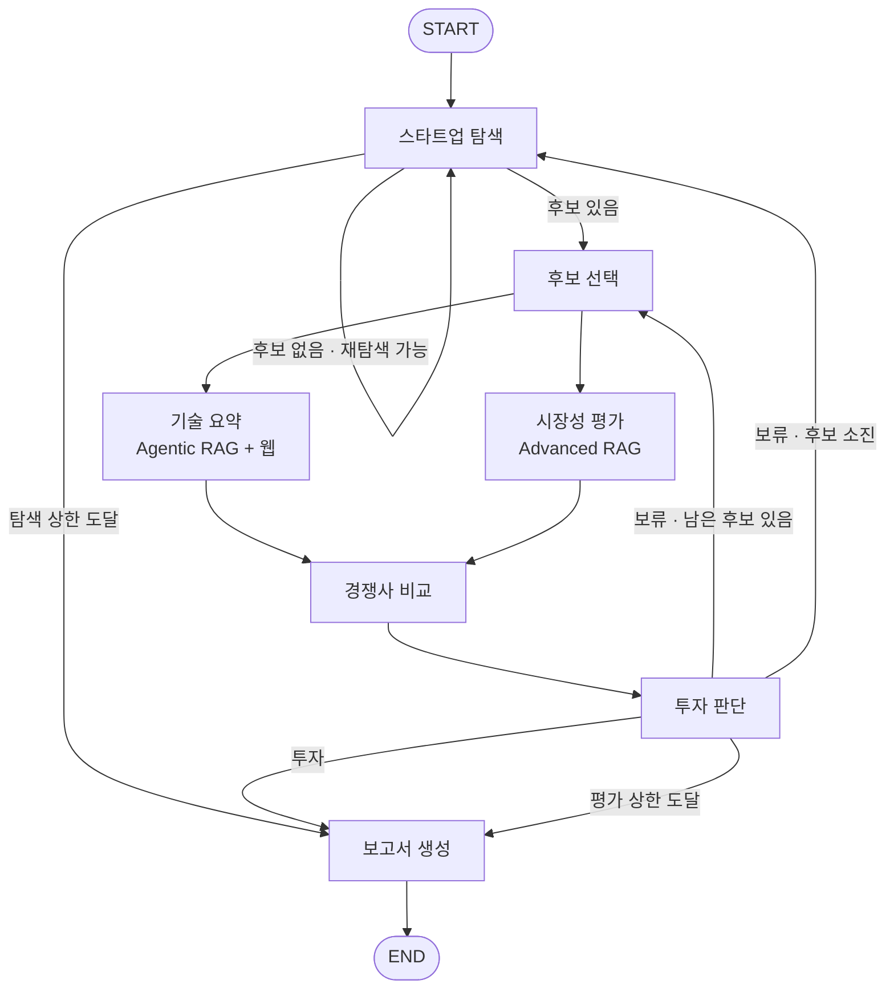
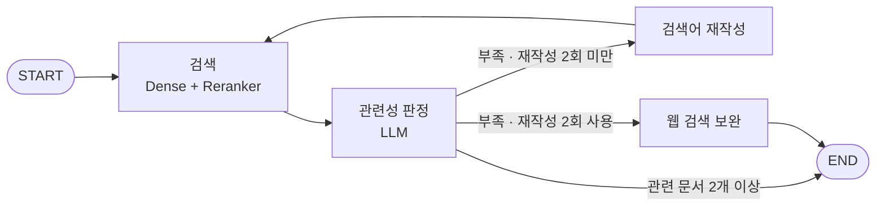

# AI Startup Investment Evaluation Agent

Energy 분야 AI 스타트업(전력 수요 예측 · 발전 예측/VPP · 배터리(ESS) 운영 · 전력망 관리)의 투자 가능성을 평가하는 LangGraph Multi-Agent 시스템입니다. 웹 검색과 문서 기반 RAG로 기술력·시장성·경쟁력을 분석하고, Bessemer/Scorecard 방식의 11개 항목 평가표로 투자 여부를 판정한 뒤, 5장 이내의 투자 평가 보고서(PDF)를 생성합니다.

> SKALA 「RAG Pipeline 설계 및 구축」 **개인 대체과제**입니다. 팀 산출물의 설계를 분석한 뒤, 각 설계 선택을 직접 측정해 확인하면서 처음부터 다시 구현했습니다. 팀 설계와 달라진 점과 그 근거는 [docs/EXPERIMENTS.md](docs/EXPERIMENTS.md)에 정리했습니다.

## Overview

- **Objective**: Energy AI 스타트업의 기술력, 시장성, 경쟁력, 팀 역량을 근거 기반으로 분석하고 투자 적합성을 판정합니다.
- **Method**: LangGraph Multi-Agent + Agentic RAG(기술 요약) + Advanced RAG(시장성 평가, Dense + Reranker)
- **Tools**: Tavily 웹 검색, Chroma 벡터 DB, 오픈소스 임베딩·리랭커(BAAI bge-m3 / bge-reranker-v2-m3)
- **대상 기업**: 비상장, Seed~Series C, M&A·IPO 등 Exit이 완료되지 않은 스타트업
- **산출물**: 투자 추천 보고서 또는 전체 보류 보고서 (PDF + Markdown), 실행 로그

## Features

- **스타트업 자동 발굴**: 웹 검색으로 후보를 찾고 투자 단계·상장 여부·Exit 여부를 검증합니다. 공개 정보가 많은 후보부터 평가합니다.
- **기술·시장 병렬 분석**: 기술 요약과 시장성 평가를 동시에 실행(fan-out)하고, 둘 다 끝나면 경쟁사 비교로 합류(fan-in)합니다.
- **Agentic RAG**: 검색한 기술 문서를 LLM이 관련성 판정하고, 부족하면 검색어를 최대 2회 고쳐 다시 찾고, 그래도 부족하면 웹 검색으로 보완합니다.
- **환각 방지**: 모든 분석 주장에 근거 번호 `[n]`을 달게 하고, 번호가 없거나 잘못된 주장은 코드가 지웁니다. 시장 수치는 원문 문장에 실제로 들어 있는지 다시 확인한 것만 보고서에 싣습니다.
- **일관된 투자 판정**: LLM은 11개 항목의 점수와 근거만 내고, 가중 합산·필수 탈락·최종 판정은 코드가 계산합니다.
- **보류 시 반복**: 보류 판정이면 다음 후보를 평가하고, 후보가 떨어지면 재탐색합니다. 모두 보류면 종료하고 보류 보고서를 씁니다. (탐색 최대 3회, 심층 평가 최대 8곳)
- **보고서 자동 생성**: 맨 앞 SUMMARY(반 페이지 이내), 맨 끝 REFERENCE(지정 형식), 5장 이내 PDF. 표·판정 문장·출처 목록은 코드가 만들어 LLM이 바꿀 수 없습니다.

## Tech Stack

| Category | Details |
|---|---|
| Language | Python 3.11 |
| Framework | LangGraph 1.2 (`StateGraph`, 조건부 라우팅, 병렬 실행), LangChain 1.4 |
| LLM (생성) | GPT-5.4 mini (`gpt-5.4-mini-2026-03-17`) via OpenAI API, reasoning `none` · temperature 0 |
| LLM (판정·채점) | GPT-5.4 (`gpt-5.4-2026-03-05`) via OpenAI API, reasoning `none` · temperature 0 |
| Retrieval | Chroma (`tech_docs` 332청크, `market_docs` 124청크), Dense + Reranker |
| Retrieval 성능 | **기술 문서 Hit Rate@5 0.950 · MRR 0.925 / 시장 보고서 Hit Rate@5 0.967 · MRR 0.844** (평가셋 50문항) |
| Embedding | `BAAI/bge-m3` (오픈소스, 로컬 실행) |
| Reranker | `BAAI/bge-reranker-v2-m3` (오픈소스, 로컬 실행) |
| Chunking | bge-m3 토크나이저 기준 400토큰 / overlap 50 (페이지 단위 분할) |
| Web Search | Tavily (`langchain-tavily`) |
| PDF | PyMuPDF(문서 읽기), markdown + fpdf2 + SUIT 폰트(보고서 출력) |
| Structured Output | Pydantic v2 |
| Test | pytest (15개) |

### 임베딩 모델 선정 이유

| 모델 | 기술 Hit@5 | 기술 MRR | 시장 Hit@5 | 시장 MRR |
|---|---:|---:|---:|---:|
| **BAAI/bge-m3 (선정)** | **0.800** | **0.627** | **0.800** | **0.612** |
| Qwen/Qwen3-Embedding-0.6B | 0.750 | 0.552 | 0.800 | 0.611 |
| intfloat/multilingual-e5-large | 0.750 | 0.571 | 0.500 | 0.367 |

*(팀 측정, 같은 청크·같은 질문으로 비교)*

- 질문은 한국어, 문서는 대부분 영어라 **다국어 임베딩**이 필요합니다. bge-m3는 100개 이상 언어를 같은 벡터 공간에 둡니다.
- 3개 모델 비교에서 기술·시장 모두 가장 높았고, 개인 구현에서 같은 모델로 다시 측정해 결과가 유효함을 확인했습니다.
- 오픈소스(MIT)로 로컬(Apple Silicon `mps`)에서 실행되어 API 비용과 외부 의존이 없습니다.

### 검색기 비교 (최종 선택 근거)

| 검색기 | 기술 Hit@5 | 기술 MRR | 시장 Hit@5 | 시장 MRR | 질문당 시간 |
|---|---:|---:|---:|---:|---:|
| Dense (bge-m3) | 0.950 | 0.863 | 0.867 | 0.648 | 0.03초 |
| BM25 (Kiwi 형태소) | 0.300 | 0.242 | 0.400 | 0.286 | 0.00초 |
| Ensemble (BM25 + Dense, RRF) | 0.900 | 0.527 | 0.667 | 0.467 | 0.02초 |
| Ensemble + Reranker | 0.950 | 0.925 | 0.967 | 0.844 | 3.13초 |
| **Dense + Reranker (최종)** | **0.950** | **0.925** | **0.967** | **0.844** | **1.95초** |

한국어 질문과 영어 문서 사이에서는 단어 일치 기반 BM25가 오히려 순위를 떨어뜨렸고, 리랭커 앞에서도 이득이 없어 Dense + Reranker를 택했습니다. 측정 코드는 `eval/retriever_eval.py`, 원본 결과는 `outputs/retriever_eval.md`, `outputs/chunking_eval.md`입니다.

### RAG 문서 (6종, 195쪽)

| 구분 | 문서 | 쪽수 |
|---|---|---:|
| 기술 | U.S. DOE (2024), AI for Energy | 59 |
| 기술 | WEF (2021), Harnessing AI to Accelerate the Energy Transition | 25 |
| 기술 | Benbouhenni & Bizon (2026), AI-Enabled BESS for Renewable Energy (Review) | 49 |
| 시장 | IEA (2025), Energy and AI | 26 |
| 시장 | U.S. DOE (2025), Pathways to Commercial Liftoff: VPP 2025 Update | 28 |
| 시장 | 포스코경영연구원 (2024), AI발 전력수요 증가에 따른 에너지 및 소재 시장 동향 | 8 |

## Agents

| 에이전트 | 역할 | 근거 수집 |
|---|---|---|
| 스타트업 탐색 (`discovery`) | 후보 발굴, 투자 단계·비상장·Exit 여부 검증, 공개 정보 충분도 순 정렬 | 웹 검색 |
| 후보 선택 (`select`) | 대기열에서 다음 후보를 꺼내고 기업별 분석 상태 초기화 (LLM 미사용) | - |
| 기술 요약 (`tech_summary`) | 핵심 기술·제품·성능·TRL·창업팀 분석 | 웹 검색 + **Agentic RAG** (업계 기술 수준·TRL 기준) |
| 시장성 평가 (`market_eval`) | 시장 규모·성장성·수요처·정책 위험, 원문 인용 검증된 수치 | **Advanced RAG** (국가·분야 필터 + Dense + Reranker) |
| 경쟁사 비교 (`competitor`) | 경쟁사 3~5곳, 차별성·진입장벽·사업 실적 | 웹 검색 + 기술·시장 분석 결과 |
| 투자 판단 (`investment_judge`) | 11개 항목 채점 → 코드가 가중 합산·판정 | 분석 결과 + 평가표 |
| 보고서 생성 (`report_writer`) | 판정에 따라 두 가지 목차로 보고서 작성, PDF 출력 | 평가 결과 + 실제 사용한 출처 |

### 투자 판정 기준 (`config/rubric.yaml`)

| 항목 | 가중치 | 항목 | 가중치 |
|---|---:|---|---:|
| 창업팀 역량 ★ | 25 | 기술 성능·고객가치 | 7 |
| 시장 규모·성장성 | 12 | 규제·정책 위험 ★ | 6 |
| 시장 수요 | 10 | 공급·확장 가능성 | 5 |
| 사업모델·Traction | 10 | 재무·투자 가능성 | 5 |
| 경쟁우위 | 8 | 투자조건 | 5 |
| 기술 성숙도 (TRL) | 7 | **합계** | **100** |

- 항목별 0~10점 × 가중치 ÷ 10 → 100점 만점. **70점 이상이면 투자**, 미만이면 보류
- ★ 필수 탈락: 창업팀 역량 또는 규제·정책 위험이 3점 이하면 총점과 관계없이 보류
- 판단 근거가 없는 항목은 중간값 5점 + '정보 부족' 표시, 보고서 '분석의 한계'에 명시

## Architecture



기술 요약 안의 Agentic RAG 서브그래프:



보고서 목차는 판정에 따라 달라집니다.

- **투자 추천**: SUMMARY → 1. 기업 및 사업 개요 → 2. 시장 및 경쟁 분석 → 3. 기업 역량 및 리스크 → 4. 종합 투자 평가 → REFERENCE
- **전체 보류**: SUMMARY → 1. 평가 대상 및 선정 과정 → 2. 후보별 평가 결과 비교 → 3. 주요 보류 사유 및 시장 환경 → 4. 분석의 한계 → REFERENCE

## Directory Structure

```text
.
├── app.py                  # 실행 진입점 (python app.py)
├── config.py               # 경로, 모델, 실행 상한값
├── state.py                # LangGraph 공유 State와 reducer
├── schemas.py              # 에이전트 입출력 Pydantic 스키마
├── graph/                  # 그래프 조립(builder), 조건부 라우팅(routing)
├── agents/                 # 6개 에이전트 + 후보 선택 노드 + 흐름 검증용 stub
├── rag/                    # 문서 인제스트, 임베딩, 벡터스토어, 검색기, Agentic RAG
├── tools/                  # LLM 호출, 웹 검색, 근거 번호 검증, 출처(REFERENCE) 형식
├── prompts/                # 에이전트별 프롬프트
├── config/
│   ├── docs.yaml           # RAG 문서 목록·사용 쪽수·출처 정보
│   └── rubric.yaml         # 11개 평가 항목, 가중치, 필수 탈락 조건
├── data/
│   ├── docs/tech/          # 기술 문서 PDF 3종
│   ├── docs/market/        # 시장 보고서 PDF 3종
│   ├── eval/               # 검색 평가셋 (기술 20문항, 시장 30문항)
│   └── seed_candidates.json
├── eval/                  # 검색기·청크 크기 비교(Hit Rate@5, MRR), Agentic RAG 질문 방식 비교
├── tests/                  # 그래프 흐름, 판정 계산, 근거 검증, 출처 형식 테스트
├── docs/EXPERIMENTS.md     # 팀 설계 대비 변경점과 측정 근거
├── assets/fonts/           # SUIT 폰트 (OFL 라이선스)
├── outputs/                # 보고서, 평가 결과, 실행 로그
├── requirements.txt
└── .env.example
```

## Usage

1. Python 3.11 가상환경을 만들고 의존성을 설치합니다.

   ```bash
   python3.11 -m venv .venv
   source .venv/bin/activate        # Windows: .venv\Scripts\activate
   pip install -r requirements.txt
   ```

2. `.env.example`을 `.env`로 복사하고 값을 채웁니다.

   ```dotenv
   OPENAI_API_KEY=...
   TAVILY_API_KEY=...
   LLM_MODEL=gpt-5.4-mini-2026-03-17
   JUDGE_MODEL=gpt-5.4-2026-03-05
   ```

3. 실행합니다. 처음 실행하면 벡터스토어를 자동으로 만든 뒤(수 분) 평가를 시작합니다.

   ```bash
   python app.py
   ```

   결과는 `outputs/`에 저장됩니다.

   | 파일 | 내용 |
   |---|---|
   | `report_YYYYMMDD_HHMMSS.pdf` | 최종 투자 평가 보고서 |
   | `report_YYYYMMDD_HHMMSS.md` | 같은 보고서의 Markdown 원문 |
   | `run_log.json` | 평가 이력, 항목별 점수, 판정, 실행 로그 |
   | `discovery_round{n}.json` | 탐색 회차별 후보 |
   | `graph.mmd` | 그래프 구조 (Mermaid) |

4. 그 밖의 명령

   ```bash
   python app.py --stub                         # API 키 없이 그래프 흐름만 확인
   python -m pytest -q                          # 테스트 15개
   python -m rag.ingest --rebuild               # 벡터스토어 다시 만들기
   python -m eval.retriever_eval                # 검색기 비교 → outputs/retriever_eval.md
   python -m eval.retriever_eval --chunking 400,600,800   # 청크 크기 비교
   python -m eval.rag_question_eval             # Agentic RAG 질문 방식 비교 (API 키 필요)
   python -m eval.consistency_eval --repeat 3   # 판정 일관성 비교 (app.py 실행 후, API 키 필요)
   python -m rag.agentic_rag "전력 수요 예측 AI의 상용화 수준은?"  # Agentic RAG 단독 실행
   ```

## Design Decisions (팀 설계 대비)

팀 설계의 뼈대(도메인, 문서, 평가 항목, 그래프 구조, Agentic RAG 판정 기준)는 유지하고, **측정 결과나 팀 보고서에서 확인된 문제가 있을 때만** 바꿨습니다. 자세한 측정과 이유는 [docs/EXPERIMENTS.md](docs/EXPERIMENTS.md)에 있습니다.

| 항목 | 팀 설계 | 개인 구현 | 근거 |
|---|---|---|---|
| 청킹 | 글자 수 기준 (약 800토큰) | 토큰 400 / overlap 50 | 50문항 평균 MRR 0.684 → 0.734 |
| 시장성 검색 | BM25 + Dense + Reranker | Dense + Reranker | BM25가 한국어 질문·영어 문서에서 역효과, 1.6배 빠름 |
| 기술 요약 검색 | Dense Top-5 | Dense + Reranker | 기술 MRR 0.863 → 0.925 |
| 후보 정렬 | 유망도 순 | 공개 정보 충분도 순 | 팀 보고서는 모든 후보가 '정보 부족' 항목 과다로 보류됨 |
| 시장 수치 검증 | 인용 번호 확인 | 원문 문장 일치 검증 추가 | 팀 보고서에서 수치가 원문과 다른 뜻으로 인용됨 |
| Agentic RAG 질문·판정 | 팀 원문 | **유지** | 질문 분해는 통과 문서 18개 vs 10개였지만 4개 분야 모두 재작성 2회 + 웹 보완이 필요해 비용 대비 이득이 작음 |

## Limitations

- 비상장 기업의 매출·밸류에이션은 대부분 공개되지 않아 '투자조건' 항목은 정보 부족(5점)으로 처리되는 경우가 많습니다.
- 근거 번호 `[n]`이 달렸는지는 코드가 검증하지만, 문장 내용이 원문과 일치하는지 대조하는 것은 시장 수치뿐입니다.
- 검색 성능(Hit Rate@5, MRR)은 설정을 고른 같은 50문항으로 측정해 실제보다 높게 나왔을 수 있습니다.
- 시장 문서에 분야별(예: 수요 예측 소프트웨어) 시장 규모 자료가 없어, 시장 규모는 인접 시장 수치로 판단합니다.
- LLM 출력이 실행마다 조금씩 달라 같은 기업도 총점이 몇 점씩 달라질 수 있습니다. 최종 설정으로 Amperon을 두 번 실행했을 때 75.3점과 70.7점(모두 투자, 기준 70점)이었고, 같은 입력을 다시 채점했을 때의 차이는 약 2점이었습니다. 나머지 차이는 앞 단계(기술 요약, 통과한 기술 문서)가 달라져 채점 입력이 바뀐 데서 옵니다.
- 웹 검색 결과에 이름이 같은 다른 회사 자료가 섞일 수 있어 프롬프트로 금지하지만 완전히 걸러지지는 않을 수 있습니다.

자세한 내용과 개선 방향은 [docs/EXPERIMENTS.md](docs/EXPERIMENTS.md) 6·7번에 있습니다.

## Contributors

- **홍동완** ([@gitwan032](https://github.com/gitwan032)): 개인 대체과제로 전체 구현. 팀 산출물 분석, RAG 파이프라인 재구현과 검색기·청킹 비교 실험, LangGraph 그래프와 6개 에이전트, 근거 검증, 보고서 생성, 테스트, 문서화
- 원 설계: SKALA 팀 프로젝트 (2026-09-30) 산출물. 도메인·문서 선정·평가표·그래프 구조를 바탕으로 함
